<!-- Header: animated wave in Tokyo Night colours (same palette as my Omarchy rice) -->
<p align="center">
  
</p>

<p align="center">
  <a href="https://github.com/VIKking96">
    
  </a>
</p>

<p align="center">
  <a href="https://www.linkedin.com/in/ahmed-amr-helal"></a>
  <a href="mailto:ahmed.amrohelal@gmail.com"></a>
  
</p>

---

### 👋 About me

<p align="center">
  
</p>

<table>
<tr>
<td width="58%" valign="middle">

- 🔭 Currently learning **Linux administration, Bash, Docker and CI/CD**
- 🌱 Next on the path: **Kubernetes, Terraform, Ansible, monitoring**
- 💬 Ask me about **Arch Linux, ricing Hyprland, or Neovim setups**
- ⚡ Fun fact: I fix my own broken boot loader before breakfast

</td>
<td width="42%" valign="top" align="center">


</td>
</tr>
</table>

---

### 🧰 Toolbelt

**Using**

<p align="left">
  
</p>

**On the roadmap** (Route DevOps Diploma)

<p align="left">
  
</p>

---

### 🗺️ DevOps roadmap

```diff
+ [x] CS degree                       (2024)
+ [x] Arch Linux as my daily driver
! [~] Route DevOps Diploma             (in progress, until Mar 2027)
! [~] Linux + Bash                     (in progress)
- [ ] server-stats: Bash monitoring script
- [ ] Docker + GitHub Actions + Terraform project
- [ ] AWS Cloud Practitioner
- [ ] First DevOps job 🎯
```

---

### 📊 Activity

<p align="center">
  
</p>

<!-- Snake: generated by .github/workflows/snake.yml into the "output" branch -->
<p align="center">
  <picture>
    <source media="(prefers-color-scheme: dark)" srcset="https://raw.githubusercontent.com/VIKking96/VIKking96/output/github-snake-dark.svg"/>
    <source media="(prefers-color-scheme: light)" srcset="https://raw.githubusercontent.com/VIKking96/VIKking96/output/github-snake.svg"/>
    
  </picture>
</p>

<p align="center">
  
</p>
