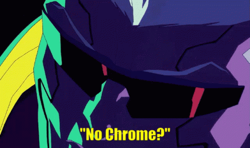

<!-- Header: animated wave in my Omarchy theme's colours (Dos Moos) -->

  

  

  
  
  

---

### 👋 About me

<table>
<tr>
<td width="60%" valign="middle">
  
</td>
<td width="40%" valign="middle" align="center">
  
</td>
</tr>
</table>

- 🔭 Currently learning **Linux administration, Bash, Docker and CI/CD**
- 🌱 Next on the path: **Kubernetes, Terraform, Ansible, monitoring**
- 💬 Ask me about **Arch Linux, ricing Hyprland, or Neovim setups**
- ⚡ Fun fact: I fix my own broken boot loader before breakfast

---

### 🧰 Toolbelt

**Using**

  

**On the roadmap**

  

---

### 📊 Activity

  

<!-- Pac-Man (I use Arch, so: pacman): drawn daily by .github/workflows/profile.yml into the "output" branch -->

  <picture>
    <source media="(prefers-color-scheme: dark)" srcset="https://raw.githubusercontent.com/VIKking96/VIKking96/output/pacman-contribution-graph-dark.svg"/>
    <source media="(prefers-color-scheme: light)" srcset="https://raw.githubusercontent.com/VIKking96/VIKking96/output/pacman-contribution-graph.svg"/>
    
  </picture>

  

